# Ribbon experiment

Material for the community discussion on how the RustGIS ribbon should be organised. Nothing here
is meant to be merged as is.

## Files

| File | What it is |
|---|---|
| [ribbon-audit.md](ribbon-audit.md) | Inventory of the ribbon as it is: every tab, group and dropdown, what each control opens, estimated usage, and where things repeat |
| [ribbon-rulebook.md](ribbon-rulebook.md) | A draft rule book: which features get a ribbon control, and which kind |
| [ribbon-proposal.md](ribbon-proposal.md) | One possible new layout that applies the rule book |
| [ribbon-arcgis.md](ribbon-arcgis.md) | How ArcGIS Pro organises its ribbon, with sources |
| [ribbon-qgis.md](ribbon-qgis.md) | How QGIS and its experimental Ribbon Toolbar plugin do it, with sources |

## The prototype

This branch also contains a prototype of `ribbon-proposal.md` (the commit before the one adding
this folder). To try it:

```sh
cargo run --release -p rustgis
```

Notes:

- The audit and the prototype are based on `main` at `c281e2a`, before #855 added the Select
  split button (Polygon, Lasso, Radius). In the prototype, Select is a plain button.
- At 1366 px wide, the View, Analyze and Style (polygon layer) tabs still need the scroll arrows.
- The usage ratings in the audit are estimates, not measurements.

## Screenshots of the prototype

Headless shots of the ribbon strip (`cargo run --release -p rustgis-ui-egui --example ui_shot --
experiment/screenshots/script.jsonl`), 1366 px wide at 2×, World Atlas sample. The Style shots
have Countries (polygons) or Cities (points) selected. The `wide-*` shots (from `wide.jsonl`) are
2600 px wide and show the tabs that don't fit at 1366 px in full.

| Tab | Screenshot |
|---|---|
| Home | 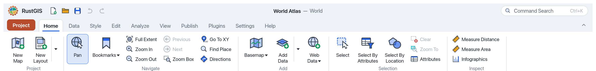 |
| Data | 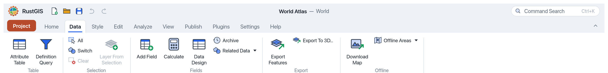 |
| Style, polygon layer | 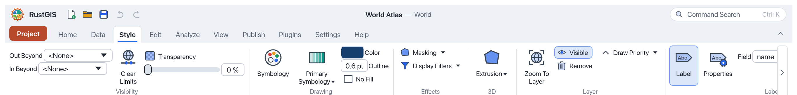 |
| Style, point layer | 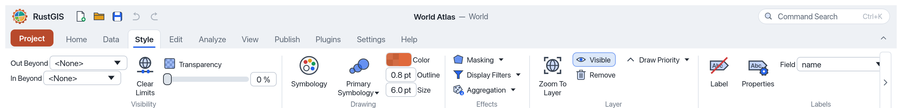 |
| Edit | 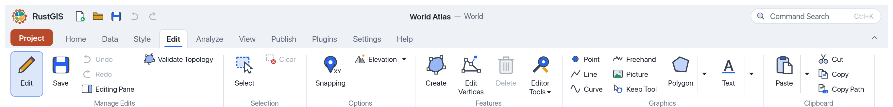 |
| Analyze | 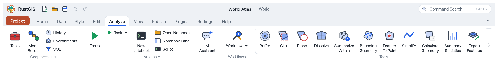 |
| View | 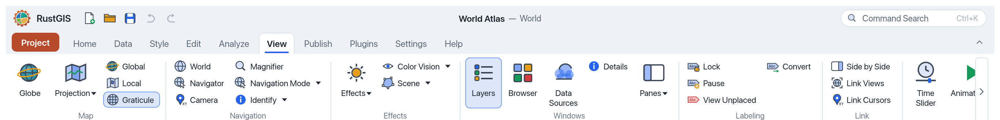 |
| View, Panes menu open | 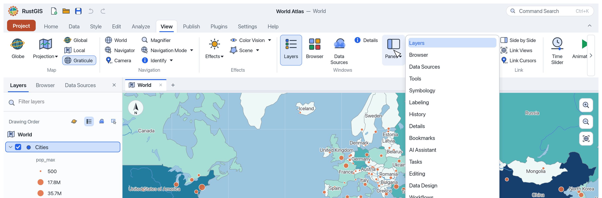 |
| Publish | 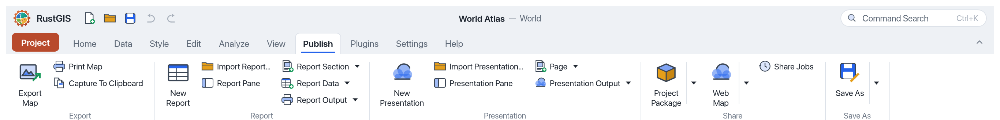 |
| Publish, layout open |  |
| Layout | 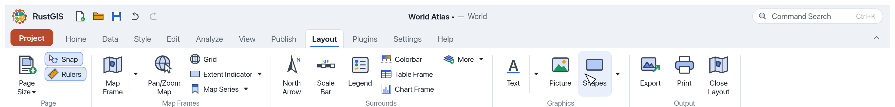 |
| Plugins | 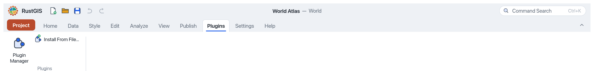 |
| Settings | 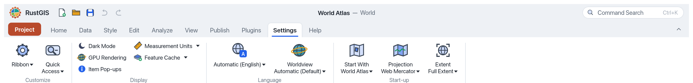 |
| Help | 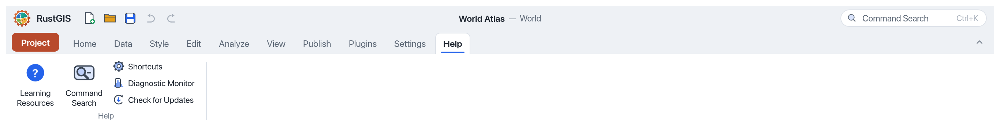 |
| Backstage, Start page | 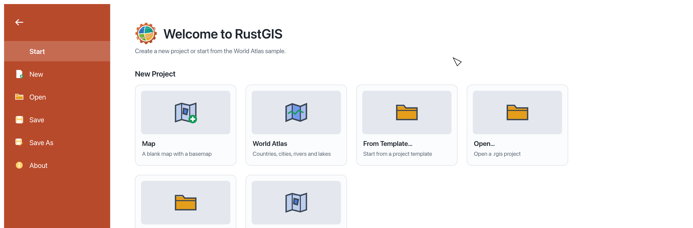 |
| Analyze, full width | 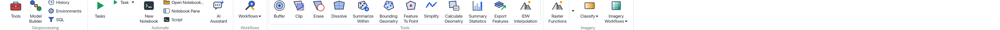 |
| View, full width |  |
| Style polygon, full width | 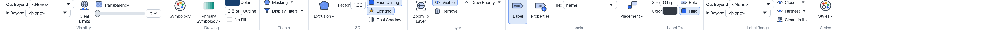 |
| Style point, full width | 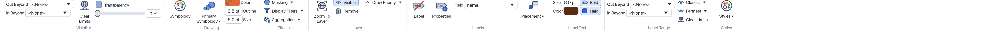 |
